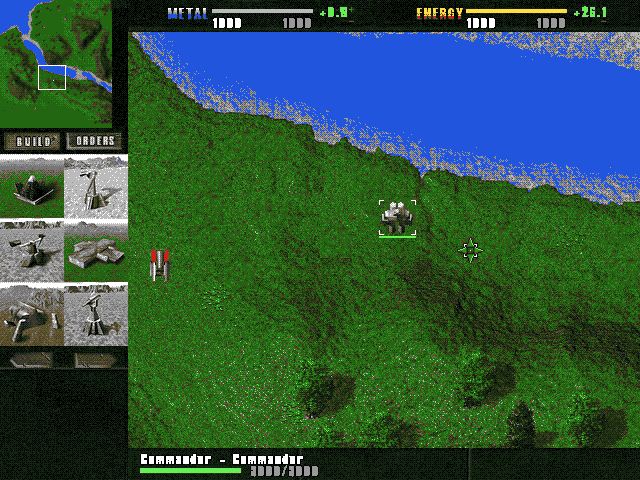

# AnnihilaTTion

Total Annihilation engine for the Atari TT, by [Neil Rackett](https://neilrackett.com/atarist)

## Introduction

Total Annihilation, the real-time strategy classic, on an Atari TT!

AnnihilaTTion is a demake of the free Total Annihilation demo for the TT030,
in TT medium resolution: 640x480 in 16 colours, the same screen size as the
original. It plays the demo's three Arm missions with their briefings and
spoken narration, its 32 Arm and CORE units, its maps and its missions'
scripts, all converted from the demo's own data. It's not quite _total_, as
the TT needs a few compromises, but it's recognisably Total Annihilation.

[Watch the full video](docs/images/annihilattion.mp4), with sound: the menus,
the briefing and the march on the CORE KBot base.

- [Playing](docs/playing.md): what it plays and leaves out, controls, and
  running it on a TT
- [Building](docs/building.md): getting the demo and building the game
- [How it works](docs/how-it-works.md): the converter and the engine
- [Testing](docs/testing.md): scripted test runs in Hatari
- [On a Falcon](docs/falcon.md): an experiment

In future, hopefully the full game will be supported, but for now, enjoy
the demo!

## Run

AnnihilaTTion plays the demo's own data, which isn't included here, so you
convert it yourself. The easiest way is in your browser:

1. Download **Total Annihilation.exe**, the demo's installer, from the
   [Internet Archive](https://archive.org/details/TotalAnnihilation_201405)
1. Drop it on the [data converter](https://labs.neilrackett.com/ataritt-annihilattion/),
   which gives you an `ANNIHILA` folder with the converted data in its
   `DATA` folder, and `ANNIHILA.TOS` beside it
1. Copy the folder to your TT's hard disk and run `ANNIHILA.TOS`

Or build it all on a Mac or Linux:

1. Download **Total Annihilation.exe**, the demo's installer, from the
   [Internet Archive](https://archive.org/details/TotalAnnihilation_201405)
   and put it in `tmp/ta-demo/`
1. Run `./build.sh` (see [Building](docs/building.md))
1. Copy `ANNIHILA.TOS` and the `DATA` folder in `dist` to a folder on
   your TT's hard disk and run `ANNIHILA.TOS`

To try it first, `make play` plays it in [Hatari](https://www.hatari-emu.org).

## Controls

| Input | Action |
| --- | --- |
| Left click | Select a unit; with units selected, move, attack, or reclaim a tree or wreck |
| Left drag | Select the units in a box |
| Right click | Cancel an order, or clear the selection |
| Minimap | Left click to look there, right click to send the selected units there |
| M, A, S, P, G, D, R | Move, Attack, Stop, Patrol, Guard, D-gun, Reclaim |
| B, O | Build or Orders page |
| C | Find the Commander |
| Esc | Pause (Q then quits the mission) |

See [Playing](docs/playing.md) for the rest.

## System requirements

- Atari TT030 with TOS 3.06, 2MB ST-RAM and 4MB TT-RAM
- A colour monitor for TT medium resolution
- About 7MB of hard disk space
- Experimental: a Falcon030 with a VGA monitor, an RGB monitor or a TV,
  and 6MB free RAM (see [On a Falcon](docs/falcon.md))

## Build

1. Install [atarist-toolkit-docker](https://github.com/neilrackett/atarist-toolkit-docker),
   whose `stcmd` carries the gcc 13 `m68k-atari-mintelf` cross compiler, and
   `python3` with numpy and Pillow
1. Open the command line and navigate to the project directory
1. Run `./build.sh` to unpack and convert the demo's data and compile the game
1. `ANNIHILA.TOS` and its `DATA` folder will be created in `dist`

`stcmd make` compiles the program alone, into `dist/ANNIHILA.TOS`.

## Credits

- Created by [Neil Rackett](https://neilrackett.com/atarist)
- Inspired by [Open Annihilation](https://github.com/open-annihilation/open-annihilation)
  by Steve Gray and its [contributors](https://github.com/open-annihilation/open-annihilation/blob/main/CONTRIBUTORS.md)
- [Total Annihilation](https://en.wikipedia.org/wiki/Total_Annihilation) (1997)
  by Cavedog Entertainment, whose free demo it plays

AnnihilaTTion is not affiliated with or endorsed by the owners of Total
Annihilation, whose name and content are the copyright and trademarks of
their respective owners. No game data is included: it plays the demo's data
from your own download.

## License

Released under [GNU General Public License v3.0 or later](LICENSE)
